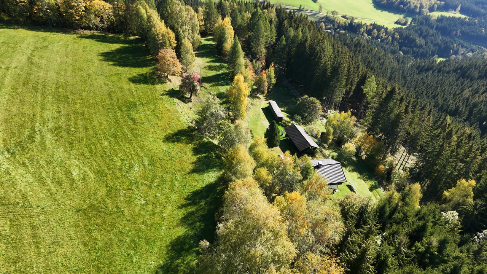
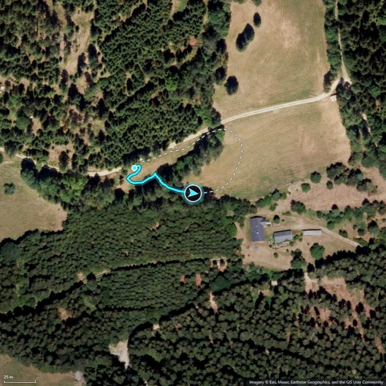
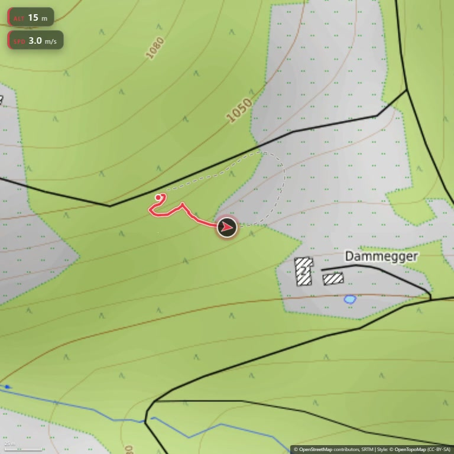

# neo2-flightpath

Render **flight-path map overlay videos** from DJI drone recordings (DJI Neo 2
and similar): a growing trail, a heading arrow and a live map, rendered at
**exactly the source frame rate and frame count** so the result drops 1:1 onto
the original footage in any video editor.

Telemetry comes from the recording's **`.SRT` sidecar** (DJI SubRip, one cue per
frame) or, when there is none, from the **embedded `CAM meta` stream** (DJI's
internal DVTM protobuf telemetry inside the MP4).

## Quick start

```sh
# from GitHub
npx github:MrManny/neo2-flightpath "my-flight.mp4"

# from npm
npx neo2-flightpath "my-flight.mp4"

# topographic map, altitude + speed HUD
npx neo2-flightpath "my-flight.mp4" --style topo --hud heading,alt,speed
```

Output lands beside the source video as `<basename>_map.mp4` (configurable).

### Example output

All frames below are from the same recording:



*Source footage at 1:20 — the flight recording the examples below are rendered from.*



*Default settings (first two commands): satellite map, growing trail and heading arrow.*



*`--style topo --hud heading,alt,speed` (third command): topographic map with heading, altitude and speed chips.*

## Requirements

- **Node.js >= 24**
- **ffmpeg + ffprobe** on `PATH` (telemetry extraction and video encoding).
  Windows: `winget install Gyan.FFmpeg`; macOS: `brew install ffmpeg`;
  Linux: `apt install ffmpeg`.
- **Google Chrome or Microsoft Edge** installed — rendering uses the system
  browser via `playwright-core`, which itself never downloads a browser. No
  system browser either? `npx playwright install chromium` works too (the
  Playwright browser registry is tried automatically), and any Chromium
  executable can be forced with `--browser <path>`.
- Internet on the first run: map tiles are fetched politely and cached
  permanently afterwards (see *Tiles & attribution*).

## Usage

```
neo2-flightpath <inputs...> [options]
```

`<inputs...>` are `.mp4` files and/or folders (folders are scanned for `*.mp4`,
optionally with `--recurse`). Every recording is processed independently.

| Option | Default | Meaning |
|---|---|---|
| `--out-dir <dir>` | beside source | output folder |
| `--out-suffix <suffix>` | `_map` | output name = `<basename><suffix>.mp4` |
| `--width <px>` / `--height <px>` | `768` / `768` | canvas size (rounded down to even) |
| `--style <name>` | `satellite` | `satellite` (Esri World Imagery) or `topo` (OpenTopoMap) |
| `--view <mode>` | `follow` | `follow`: drone centered, map slides under it; `overview`: static whole-track map |
| `--zoom <n>` | `0` | fixed view zoom (`0` = auto-fit to the track) |
| `--zoom-out <n>` | `1` | auto-fit only: pull the camera back *n* zoom levels |
| `--intro-sec <s>` / `--outro-sec <s>` | `2` / `2` | smoothstep zoom-in intro / zoom-out outro |
| `--hud <list>` | `heading` | comma list of `heading`, `alt`, `speed` — or `none`; the `alt` chip hides automatically when the telemetry has no altitude |
| `--workers <n>` | `4` | parallel browser capture pages |
| `--capture <mode>` | `jpeg` | `jpeg` (q95 screenshots, ~5x faster) or `png`; `canvas` is parked |
| `--preset <name>` | `medium` | x264 preset (`medium` \| `veryfast`) |
| `--trail <mode>` | `full` | trail update strategy (`full` \| `incr`) |
| `--tile-cache <dir>` | per-user cache | tile cache directory |
| `--browser <path>` | system Chrome/Edge | browser executable |
| `--skip-existing` | off | skip recordings whose output exists and matches the source (frame count + frame rate) |
| `--recurse` | off | scan input folders recursively |
| `--json` | off | print one NDJSON summary line per recording on stdout (progress stays on stderr) |
| `--config <path>` | auto | config file (see below) |
| `-q, --quiet` | off | suppress progress output |

The heading arrow shows **drone yaw** when the `CAM meta` stream provides it
(valid even while hovering), otherwise the yaw is computed from the track.

## Examples

```sh
# quick conversion: one video, all default settings
neo2-flightpath "flight.mp4"

# full flight-path video: topographic map and the complete HUD
# (heading arrow + altitude + speed chips)
neo2-flightpath "flight.mp4" --style topo --hud heading,alt,speed
```

## Config file

Options can live in a `.neo2flightpath.json` discovered upward from the working
directory (or named explicitly with `--config`). A complete example lives in
[.neo2flightpath.example.json](.neo2flightpath.example.json).

All keys are optiona. Anything omitted falls back to the default in the
option table above.

## Telemetry sources

- **`.SRT` sidecar** (preferred): same basename as the video, one cue per frame.
- **`CAM meta` / DVTM** (fallback): DJI's per-frame protobuf telemetry embedded
  in the MP4 `data` stream (`djmd` sample entry). Decoded field map:
  `GpsBasic{lat, lon, gps_altitude_mm}`, `RelativeAltitude` (mm),
  `AbsoluteAltitude` (m), `EulerAngle{pitch, roll, yaw}` (deci-degrees).

Recordings without any telemetry source are rejected with a clear message.

## Tiles & attribution

- `satellite`: Esri World Imagery — attribution *Imagery © Esri, Maxar,
  Earthstar Geographics, and the GIS User Community* (Esri usage limits apply).
- `topo`: OpenTopoMap — attribution *© OpenStreetMap contributors, SRTM |
  Style: © OpenTopoMap (CC-BY-SA)*.

Attribution is rendered into every frame. Tiles are fetched at a polite rate
(~2.5 requests/s, custom `User-Agent`), cached permanently, and failed tiles
are retried on the next run.
Do not mass-produce tiles against the public endpoints.

## License

MIT — see [LICENSE](LICENSE).
